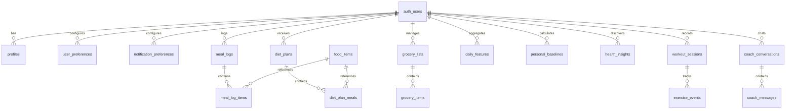

# HEALTH PLUS — Complete Relational Database Schema & DDL Specification

> **Document Version:** 1.0.0  
> **Database Engine:** PostgreSQL 16 (Supabase Managed)  
> **Status:** Production Standard  
> **Author:** CASA Vital Data Architecture  

---

## 1. Schema Design Principles

1. **UUID Primary Keys:** All tables use `uuid_generate_v4()` for cryptographically secure, collision-resistant primary keys.
2. **Immutable Nutrition Snapshots:** `meal_log_items` stores a physical copy of calorie and macronutrient values at the time of logging (`calories_kcal`, `protein_g`, `carbs_g`, `fat_g`). This prevents historical meal logs from changing if master food items are subsequently edited or re-calibrated.
3. **Strict Multi-Tenant Row Level Security (RLS):** Every user-specific table has an explicit foreign key `user_id UUID REFERENCES auth.users(id) ON DELETE CASCADE` and an enforced RLS policy permitting access solely when `auth.uid() = user_id`.
4. **Performance Indexing:** Foreign keys, date filters, and user lookup columns are explicitly indexed with B-Tree indices.

---

## 2. Entity-Relationship Diagram (ERD)



---

## 3. Complete PostgreSQL DDL Script

```sql
-- Enable UUID extension
CREATE EXTENSION IF NOT EXISTS "uuid-ossp";

-- ============================================================================
-- 1. PROFILES & USER PREFERENCES
-- ============================================================================

CREATE TABLE IF NOT EXISTS public.profiles (
    id UUID PRIMARY KEY REFERENCES auth.users(id) ON DELETE CASCADE,
    display_name TEXT NOT NULL,
    age INT CHECK (age >= 13 AND age <= 120),
    height_cm NUMERIC(5,2) CHECK (height_cm > 50 AND height_cm < 300),
    weight_kg NUMERIC(5,2) CHECK (weight_kg > 20 AND weight_kg < 500),
    gender TEXT CHECK (gender IN ('male', 'female', 'other', 'prefer_not_to_say')),
    activity_level TEXT CHECK (activity_level IN ('sedentary', 'lightly_active', 'moderately_active', 'very_active', 'extra_active')),
    fitness_goal TEXT CHECK (fitness_goal IN ('weight_loss', 'maintenance', 'muscle_gain', 'endurance', 'general_wellness')),
    bmr_kcal NUMERIC(6,2),
    tdee_kcal NUMERIC(6,2),
    target_calories_kcal NUMERIC(6,2),
    target_protein_g NUMERIC(5,1),
    target_carbs_g NUMERIC(5,1),
    target_fat_g NUMERIC(5,1),
    onboarding_completed BOOLEAN DEFAULT FALSE,
    avatar_url TEXT,
    created_at TIMESTAMPTZ DEFAULT NOW(),
    updated_at TIMESTAMPTZ DEFAULT NOW()
);

CREATE TABLE IF NOT EXISTS public.user_preferences (
    user_id UUID PRIMARY KEY REFERENCES auth.users(id) ON DELETE CASCADE,
    dietary_style TEXT DEFAULT 'vegetarian' CHECK (dietary_style IN ('vegetarian', 'vegan', 'eggetarian', 'non_vegetarian', 'jain', 'pescatarian')),
    regional_preference TEXT[] DEFAULT ARRAY['North Indian']::TEXT[],
    food_allergies TEXT[] DEFAULT ARRAY[]::TEXT[],
    disliked_foods TEXT[] DEFAULT ARRAY[]::TEXT[],
    food_budget_tier TEXT DEFAULT 'medium' CHECK (food_budget_tier IN ('budget', 'medium', 'premium')),
    preferred_meal_timings JSONB DEFAULT '{"breakfast": "08:30", "lunch": "13:30", "dinner": "20:30"}'::JSONB,
    exercise_preferences TEXT[] DEFAULT ARRAY['squats', 'pushups']::TEXT[],
    camera_consent BOOLEAN DEFAULT FALSE,
    ai_context_consent BOOLEAN DEFAULT TRUE,
    created_at TIMESTAMPTZ DEFAULT NOW(),
    updated_at TIMESTAMPTZ DEFAULT NOW()
);

CREATE TABLE IF NOT EXISTS public.notification_preferences (
    user_id UUID PRIMARY KEY REFERENCES auth.users(id) ON DELETE CASCADE,
    meal_reminders BOOLEAN DEFAULT TRUE,
    workout_reminders BOOLEAN DEFAULT TRUE,
    weekly_story_notifications BOOLEAN DEFAULT TRUE,
    diet_plan_updates BOOLEAN DEFAULT TRUE,
    created_at TIMESTAMPTZ DEFAULT NOW(),
    updated_at TIMESTAMPTZ DEFAULT NOW()
);

-- ============================================================================
-- 2. FOOD DATABASE & NUTRITION DIARY
-- ============================================================================

CREATE TABLE IF NOT EXISTS public.food_items (
    id UUID PRIMARY KEY DEFAULT uuid_generate_v4(),
    ifct_code TEXT UNIQUE, -- e.g. "IFCT-A011", "IFCT-D012" from ICMR-NIN 2017 tables
    name TEXT NOT NULL,
    alternate_names TEXT[],
    category TEXT NOT NULL CHECK (category IN ('grains', 'pulses', 'vegetables', 'dairy', 'fruits', 'snacks', 'curries', 'beverages', 'sweets', 'condiments')),
    cuisine_region TEXT DEFAULT 'Indian',
    serving_unit TEXT NOT NULL, -- e.g. "1 bowl (150g)", "1 medium roti (35g)"
    serving_weight_g NUMERIC(6,2) NOT NULL,
    calories_kcal NUMERIC(6,2) NOT NULL,
    protein_g NUMERIC(5,2) NOT NULL,
    carbs_g NUMERIC(5,2) NOT NULL,
    fat_g NUMERIC(5,2) NOT NULL,
    fiber_g NUMERIC(5,2) DEFAULT 0,
    sodium_mg NUMERIC(6,2) DEFAULT 0,
    potassium_mg NUMERIC(6,2) DEFAULT 0,
    iron_mg NUMERIC(5,2) DEFAULT 0,
    calcium_mg NUMERIC(6,2) DEFAULT 0,
    glycemic_index NUMERIC(4,1), -- GI value (e.g. 52.0 for sprouted ragi)
    is_verified BOOLEAN DEFAULT TRUE,
    dataset_source TEXT DEFAULT 'IFCT_2017_ICMR_NIN',
    created_at TIMESTAMPTZ DEFAULT NOW()
);

-- Master Recipes Catalog for Data-Driven Diet Engine
CREATE TABLE IF NOT EXISTS public.recipes (
    id UUID PRIMARY KEY DEFAULT uuid_generate_v4(),
    title TEXT NOT NULL,
    cuisine_type TEXT NOT NULL, -- e.g. "North Indian", "South Indian"
    prep_time_minutes INT NOT NULL,
    cook_time_minutes INT NOT NULL,
    total_calories_kcal NUMERIC(6,2) NOT NULL,
    total_protein_g NUMERIC(5,2) NOT NULL,
    total_carbs_g NUMERIC(5,2) NOT NULL,
    total_fat_g NUMERIC(5,2) NOT NULL,
    total_fiber_g NUMERIC(5,2) NOT NULL,
    total_sodium_mg NUMERIC(6,2) NOT NULL,
    total_potassium_mg NUMERIC(6,2) NOT NULL,
    dietary_tags TEXT[], -- e.g. ARRAY['high_protein', 'lacto_veg', 'gluten_free', 'low_gi']
    allergen_tags TEXT[], -- e.g. ARRAY['dairy', 'nuts', 'gluten']
    cooking_instructions TEXT[] NOT NULL,
    why_recommended_template TEXT,
    created_at TIMESTAMPTZ DEFAULT NOW()
);

CREATE TABLE IF NOT EXISTS public.recipe_ingredients (
    id UUID PRIMARY KEY DEFAULT uuid_generate_v4(),
    recipe_id UUID NOT NULL REFERENCES public.recipes(id) ON DELETE CASCADE,
    food_item_id UUID REFERENCES public.food_items(id) ON DELETE RESTRICT,
    ingredient_name TEXT NOT NULL,
    quantity_amount TEXT NOT NULL, -- e.g. "180g", "1 tsp"
    weight_grams NUMERIC(6,2) NOT NULL,
    ifct_code TEXT,
    created_at TIMESTAMPTZ DEFAULT NOW()
);

CREATE TABLE IF NOT EXISTS public.meal_logs (
    id UUID PRIMARY KEY DEFAULT uuid_generate_v4(),
    user_id UUID NOT NULL REFERENCES auth.users(id) ON DELETE CASCADE,
    meal_type TEXT NOT NULL CHECK (meal_type IN ('breakfast', 'lunch', 'snacks', 'dinner')),
    log_date DATE NOT NULL DEFAULT CURRENT_DATE,
    logged_at TIMESTAMPTZ NOT NULL DEFAULT NOW(),
    source TEXT NOT NULL CHECK (source IN ('camera_scan', 'manual_search', 'diet_plan_quicklog')),
    image_url TEXT,
    notes TEXT,
    total_calories_kcal NUMERIC(6,2) DEFAULT 0,
    total_protein_g NUMERIC(5,2) DEFAULT 0,
    total_carbs_g NUMERIC(5,2) DEFAULT 0,
    total_fat_g NUMERIC(5,2) DEFAULT 0,
    created_at TIMESTAMPTZ DEFAULT NOW()
);

CREATE TABLE IF NOT EXISTS public.meal_log_items (
    id UUID PRIMARY KEY DEFAULT uuid_generate_v4(),
    meal_log_id UUID NOT NULL REFERENCES public.meal_logs(id) ON DELETE CASCADE,
    food_item_id UUID REFERENCES public.food_items(id) ON DELETE SET NULL,
    custom_name TEXT,
    portion_multiplier NUMERIC(4,2) NOT NULL DEFAULT 1.0,
    portion_description TEXT, -- e.g. "2 Rotis"
    -- Immutable nutrition snapshot at the time of logging
    calories_kcal NUMERIC(6,2) NOT NULL,
    protein_g NUMERIC(5,2) NOT NULL,
    carbs_g NUMERIC(5,2) NOT NULL,
    fat_g NUMERIC(5,2) NOT NULL,
    confidence_score NUMERIC(4,3), -- from vision scanner (e.g. 0.942)
    created_at TIMESTAMPTZ DEFAULT NOW()
);

-- ============================================================================
-- 3. DIET PLANS & GROCERY LISTS
-- ============================================================================

CREATE TABLE IF NOT EXISTS public.diet_plans (
    id UUID PRIMARY KEY DEFAULT uuid_generate_v4(),
    user_id UUID NOT NULL REFERENCES auth.users(id) ON DELETE CASCADE,
    plan_name TEXT NOT NULL,
    start_date DATE NOT NULL,
    end_date DATE NOT NULL,
    daily_calorie_target NUMERIC(6,2) NOT NULL,
    daily_protein_target_g NUMERIC(5,2) NOT NULL,
    daily_carbs_target_g NUMERIC(5,2) NOT NULL,
    daily_fat_target_g NUMERIC(5,2) NOT NULL,
    is_active BOOLEAN DEFAULT TRUE,
    created_at TIMESTAMPTZ DEFAULT NOW()
);

CREATE TABLE IF NOT EXISTS public.diet_plan_meals (
    id UUID PRIMARY KEY DEFAULT uuid_generate_v4(),
    diet_plan_id UUID NOT NULL REFERENCES public.diet_plans(id) ON DELETE CASCADE,
    day_of_week INT NOT NULL CHECK (day_of_week BETWEEN 1 AND 7), -- 1=Monday, 7=Sunday
    meal_type TEXT NOT NULL CHECK (meal_type IN ('breakfast', 'lunch', 'snacks', 'dinner')),
    food_item_id UUID REFERENCES public.food_items(id) ON DELETE RESTRICT,
    title TEXT NOT NULL,
    portion_description TEXT NOT NULL,
    calories_kcal NUMERIC(6,2) NOT NULL,
    protein_g NUMERIC(5,2) NOT NULL,
    carbs_g NUMERIC(5,2) NOT NULL,
    fat_g NUMERIC(5,2) NOT NULL,
    recipe_instructions TEXT,
    created_at TIMESTAMPTZ DEFAULT NOW()
);

CREATE TABLE IF NOT EXISTS public.grocery_lists (
    id UUID PRIMARY KEY DEFAULT uuid_generate_v4(),
    user_id UUID NOT NULL REFERENCES auth.users(id) ON DELETE CASCADE,
    title TEXT NOT NULL DEFAULT 'Weekly Grocery List',
    is_archived BOOLEAN DEFAULT FALSE,
    created_at TIMESTAMPTZ DEFAULT NOW(),
    updated_at TIMESTAMPTZ DEFAULT NOW()
);

CREATE TABLE IF NOT EXISTS public.grocery_items (
    id UUID PRIMARY KEY DEFAULT uuid_generate_v4(),
    grocery_list_id UUID NOT NULL REFERENCES public.grocery_lists(id) ON DELETE CASCADE,
    ingredient_name TEXT NOT NULL,
    category TEXT NOT NULL CHECK (category IN ('produce', 'grains', 'dairy', 'spices', 'pantry', 'other')),
    quantity NUMERIC(6,2),
    unit TEXT, -- e.g. "grams", "kg", "bunches", "pieces"
    is_purchased BOOLEAN DEFAULT FALSE,
    created_at TIMESTAMPTZ DEFAULT NOW()
);

-- ============================================================================
-- 4. EXERCISE SESSIONS & TELEMETRY
-- ============================================================================

CREATE TABLE IF NOT EXISTS public.workout_sessions (
    id UUID PRIMARY KEY DEFAULT uuid_generate_v4(),
    user_id UUID NOT NULL REFERENCES auth.users(id) ON DELETE CASCADE,
    exercise_type TEXT NOT NULL CHECK (exercise_type IN ('squats', 'pushups')),
    reps_completed INT NOT NULL CHECK (reps_completed >= 0),
    duration_seconds INT NOT NULL CHECK (duration_seconds >= 0),
    avg_form_score NUMERIC(5,2) CHECK (avg_form_score >= 0 AND avg_form_score <= 100),
    form_status TEXT NOT NULL CHECK (form_status IN ('optimal', 'good', 'needs_work', 'uncertain')),
    form_feedback_summary TEXT[],
    estimated_calories_burned NUMERIC(5,2),
    session_status TEXT NOT NULL DEFAULT 'completed' CHECK (session_status IN ('completed', 'abandoned', 'paused')),
    started_at TIMESTAMPTZ NOT NULL,
    ended_at TIMESTAMPTZ NOT NULL,
    created_at TIMESTAMPTZ DEFAULT NOW()
);

CREATE TABLE IF NOT EXISTS public.exercise_events (
    id UUID PRIMARY KEY DEFAULT uuid_generate_v4(),
    workout_session_id UUID NOT NULL REFERENCES public.workout_sessions(id) ON DELETE CASCADE,
    rep_number INT NOT NULL,
    duration_seconds NUMERIC(4,2),
    max_joint_angle NUMERIC(5,2), -- e.g. knee flexion angle in degrees
    form_assessment TEXT NOT NULL,
    feedback_cue_triggered TEXT,
    event_timestamp TIMESTAMPTZ DEFAULT NOW()
);

-- ============================================================================
-- 5. HEALTH PATTERN INTELLIGENCE & INSIGHTS
-- ============================================================================

CREATE TABLE IF NOT EXISTS public.daily_features (
    id UUID PRIMARY KEY DEFAULT uuid_generate_v4(),
    user_id UUID NOT NULL REFERENCES auth.users(id) ON DELETE CASCADE,
    feature_date DATE NOT NULL,
    total_calories_logged NUMERIC(6,2) DEFAULT 0,
    protein_consumed_g NUMERIC(5,2) DEFAULT 0,
    carbs_consumed_g NUMERIC(5,2) DEFAULT 0,
    fat_consumed_g NUMERIC(5,2) DEFAULT 0,
    meal_logging_completeness NUMERIC(3,2) DEFAULT 0, -- 1.0 = all 4 meals logged
    workout_minutes INT DEFAULT 0,
    workout_reps INT DEFAULT 0,
    avg_form_score NUMERIC(5,2),
    created_at TIMESTAMPTZ DEFAULT NOW(),
    CONSTRAINT uq_user_date UNIQUE (user_id, feature_date)
);

CREATE TABLE IF NOT EXISTS public.personal_baselines (
    id UUID PRIMARY KEY DEFAULT uuid_generate_v4(),
    user_id UUID NOT NULL REFERENCES auth.users(id) ON DELETE CASCADE,
    baseline_window_days INT NOT NULL DEFAULT 14,
    mean_daily_calories NUMERIC(6,2),
    std_daily_calories NUMERIC(6,2),
    mean_daily_protein_g NUMERIC(5,2),
    std_daily_protein_g NUMERIC(5,2),
    mean_weekly_workout_reps NUMERIC(6,2),
    mean_workout_form_score NUMERIC(5,2),
    calculated_at TIMESTAMPTZ DEFAULT NOW()
);

CREATE TABLE IF NOT EXISTS public.health_insights (
    id UUID PRIMARY KEY DEFAULT uuid_generate_v4(),
    user_id UUID NOT NULL REFERENCES auth.users(id) ON DELETE CASCADE,
    pattern_type TEXT NOT NULL CHECK (pattern_type IN ('activity_consistency', 'nutrition_consistency', 'activity_shift', 'nutrition_shift', 'co_occurrence', 'weekly_story')),
    headline TEXT NOT NULL,
    explanation TEXT NOT NULL,
    evidence_payload JSONB NOT NULL, -- transparent dates, values, and calculations
    actionable_guidance TEXT,
    confidence_score NUMERIC(3,2) NOT NULL,
    is_active BOOLEAN DEFAULT TRUE,
    user_feedback TEXT CHECK (user_feedback IN ('helpful', 'unhelpful', 'dismissed')),
    created_at TIMESTAMPTZ DEFAULT NOW()
);

-- ============================================================================
-- 6. AI COACH CONVERSATIONS
-- ============================================================================

CREATE TABLE IF NOT EXISTS public.coach_conversations (
    id UUID PRIMARY KEY DEFAULT uuid_generate_v4(),
    user_id UUID NOT NULL REFERENCES auth.users(id) ON DELETE CASCADE,
    title TEXT NOT NULL DEFAULT 'Wellness Discussion',
    created_at TIMESTAMPTZ DEFAULT NOW(),
    updated_at TIMESTAMPTZ DEFAULT NOW()
);

CREATE TABLE IF NOT EXISTS public.coach_messages (
    id UUID PRIMARY KEY DEFAULT uuid_generate_v4(),
    conversation_id UUID NOT NULL REFERENCES public.coach_conversations(id) ON DELETE CASCADE,
    sender TEXT NOT NULL CHECK (sender IN ('user', 'coach', 'system')),
    content TEXT NOT NULL,
    grounding_citations JSONB, -- references to specific date ranges, meal logs, or workout records
    created_at TIMESTAMPTZ DEFAULT NOW()
);

-- ============================================================================
-- 7. PERFORMANCE INDEXES
-- ============================================================================

CREATE INDEX IF NOT EXISTS idx_meal_logs_user_date ON public.meal_logs (user_id, log_date DESC);
CREATE INDEX IF NOT EXISTS idx_meal_log_items_log_id ON public.meal_log_items (meal_log_id);
CREATE INDEX IF NOT EXISTS idx_workout_sessions_user_time ON public.workout_sessions (user_id, started_at DESC);
CREATE INDEX IF NOT EXISTS idx_daily_features_user_date ON public.daily_features (user_id, feature_date DESC);
CREATE INDEX IF NOT EXISTS idx_health_insights_user_active ON public.health_insights (user_id, is_active, created_at DESC);
CREATE INDEX IF NOT EXISTS idx_coach_messages_conversation ON public.coach_messages (conversation_id, created_at ASC);
CREATE INDEX IF NOT EXISTS idx_food_items_name_trgm ON public.food_items USING btree (name);

-- ============================================================================
-- 8. ROW LEVEL SECURITY (RLS) POLICIES
-- ============================================================================

-- Enable RLS on all user-owned tables
ALTER TABLE public.profiles ENABLE ROW LEVEL SECURITY;
ALTER TABLE public.user_preferences ENABLE ROW LEVEL SECURITY;
ALTER TABLE public.notification_preferences ENABLE ROW LEVEL SECURITY;
ALTER TABLE public.meal_logs ENABLE ROW LEVEL SECURITY;
ALTER TABLE public.meal_log_items ENABLE ROW LEVEL SECURITY;
ALTER TABLE public.diet_plans ENABLE ROW LEVEL SECURITY;
ALTER TABLE public.diet_plan_meals ENABLE ROW LEVEL SECURITY;
ALTER TABLE public.grocery_lists ENABLE ROW LEVEL SECURITY;
ALTER TABLE public.grocery_items ENABLE ROW LEVEL SECURITY;
ALTER TABLE public.workout_sessions ENABLE ROW LEVEL SECURITY;
ALTER TABLE public.exercise_events ENABLE ROW LEVEL SECURITY;
ALTER TABLE public.daily_features ENABLE ROW LEVEL SECURITY;
ALTER TABLE public.personal_baselines ENABLE ROW LEVEL SECURITY;
ALTER TABLE public.health_insights ENABLE ROW LEVEL SECURITY;
ALTER TABLE public.coach_conversations ENABLE ROW LEVEL SECURITY;
ALTER TABLE public.coach_messages ENABLE ROW LEVEL SECURITY;

-- Read-only master table: food_items is readable by all authenticated users
ALTER TABLE public.food_items ENABLE ROW LEVEL SECURITY;
CREATE POLICY "Allow authenticated read on food_items" ON public.food_items
    FOR SELECT TO authenticated USING (true);

-- User-isolation policies:
CREATE POLICY "Users can manage own profile" ON public.profiles
    FOR ALL TO authenticated USING (auth.uid() = id) WITH CHECK (auth.uid() = id);

CREATE POLICY "Users can manage own preferences" ON public.user_preferences
    FOR ALL TO authenticated USING (auth.uid() = user_id) WITH CHECK (auth.uid() = user_id);

CREATE POLICY "Users can manage own meal_logs" ON public.meal_logs
    FOR ALL TO authenticated USING (auth.uid() = user_id) WITH CHECK (auth.uid() = user_id);

CREATE POLICY "Users can manage own meal_log_items" ON public.meal_log_items
    FOR ALL TO authenticated USING (
        EXISTS (SELECT 1 FROM public.meal_logs WHERE meal_logs.id = meal_log_items.meal_log_id AND meal_logs.user_id = auth.uid())
    ) WITH CHECK (
        EXISTS (SELECT 1 FROM public.meal_logs WHERE meal_logs.id = meal_log_items.meal_log_id AND meal_logs.user_id = auth.uid())
    );

CREATE POLICY "Users can manage own diet_plans" ON public.diet_plans
    FOR ALL TO authenticated USING (auth.uid() = user_id) WITH CHECK (auth.uid() = user_id);

CREATE POLICY "Users can manage own diet_plan_meals" ON public.diet_plan_meals
    FOR ALL TO authenticated USING (
        EXISTS (SELECT 1 FROM public.diet_plans WHERE diet_plans.id = diet_plan_meals.diet_plan_id AND diet_plans.user_id = auth.uid())
    );

CREATE POLICY "Users can manage own grocery_lists" ON public.grocery_lists
    FOR ALL TO authenticated USING (auth.uid() = user_id) WITH CHECK (auth.uid() = user_id);

CREATE POLICY "Users can manage own grocery_items" ON public.grocery_items
    FOR ALL TO authenticated USING (
        EXISTS (SELECT 1 FROM public.grocery_lists WHERE grocery_lists.id = grocery_items.grocery_list_id AND grocery_lists.user_id = auth.uid())
    );

CREATE POLICY "Users can manage own workout_sessions" ON public.workout_sessions
    FOR ALL TO authenticated USING (auth.uid() = user_id) WITH CHECK (auth.uid() = user_id);

CREATE POLICY "Users can manage own exercise_events" ON public.exercise_events
    FOR ALL TO authenticated USING (
        EXISTS (SELECT 1 FROM public.workout_sessions WHERE workout_sessions.id = exercise_events.workout_session_id AND workout_sessions.user_id = auth.uid())
    );

CREATE POLICY "Users can manage own daily_features" ON public.daily_features
    FOR ALL TO authenticated USING (auth.uid() = user_id) WITH CHECK (auth.uid() = user_id);

CREATE POLICY "Users can manage own baselines" ON public.personal_baselines
    FOR ALL TO authenticated USING (auth.uid() = user_id) WITH CHECK (auth.uid() = user_id);

CREATE POLICY "Users can manage own insights" ON public.health_insights
    FOR ALL TO authenticated USING (auth.uid() = user_id) WITH CHECK (auth.uid() = user_id);

CREATE POLICY "Users can manage own coach conversations" ON public.coach_conversations
    FOR ALL TO authenticated USING (auth.uid() = user_id) WITH CHECK (auth.uid() = user_id);

CREATE POLICY "Users can manage own coach messages" ON public.coach_messages
    FOR ALL TO authenticated USING (
        EXISTS (SELECT 1 FROM public.coach_conversations WHERE coach_conversations.id = coach_messages.conversation_id AND coach_conversations.user_id = auth.uid())
    );
```

