# HEALTH PLUS — Phased Development Roadmap & Execution Plan

> **Document Version:** 1.0.0  
> **Status:** Production Standard  
> **Author:** CASA Vital Technical Project Planning  

---

## 1. Roadmap Architecture & Execution Philosophy

HEALTH PLUS is built through 12 controlled phases (Phase 0 through Phase 11). To maintain high visual quality, technical rigor, and zero regressions:
- No phase is skipped or merged prematurely.
- Each phase requires comprehensive implementation, testing, review, and explicit approval before transitioning to the next.
- Teammate-owned modules (Exercise Studio & Pose Engine) maintain independent milestone tracks with documented contracts.

```mermaid
flowchart LR
    P0[Phase 0: Inspection & Master Docs] --> P1[Phase 1: Design Tokens & Visual Core]
    P1 --> P2[Phase 2: Premium Landing Page]
    P2 --> P3[Phase 3: Auth & Onboarding Profile]
    P3 --> P4[Phase 4: Main Dashboard Core]
    P4 --> P5[Phase 5: Food Scanner & Diary]
    P5 --> P6[Phase 6: Diet Planner & Grocery]
    P6 --> P7[Phase 7: Exercise Studio Integration]
    P7 --> P8[Phase 8: Pattern Intelligence Engine]
    P8 --> P9[Phase 9: Context-Aware AI Coach]
    P9 --> P10[Phase 10: Progress, Alerts, Settings]
    P10 --> P11[Phase 11: Audits, QA & Deployment]
```

---

## 2. Phase-by-Phase Execution Breakdown

### Phase 0: Workspace Inspection & Architecture Blueprint (Current Phase)
- **Status:** **Completed**
- **Deliverables:**
  - Complete workspace inspection (verified clean slate, preserving teammate boundaries).
  - 13 comprehensive architecture, UI/UX, and technical documents in `/docs`.
  - Defined master color tokens, typography, motion philosophy, database DDL, API contracts, and exercise boundaries.
- **Exit Criteria:** Architecture review approval from project stakeholders.

---

### Phase 1: Design System & Premium Visual Foundation
- **Deliverables:**
  - Setup Vite + React 19 + TypeScript frontend repository.
  - Setup Tailwind CSS with centralized design tokens (Forest `#123B32`, Emerald `#187A5B`, Sage `#DDECE3`, Ivory `#FAF9F5`, Gold `#E7B76B`).
  - Implement base ambient animated background components (`AmbientBackground`, `AmbientOrb`, `ParticleMesh`).
  - Implement core UI primitives: Pill buttons, glass cards, form inputs, radial progress rings, modal dialogs, status badges.
  - Implement accessibility & `prefers-reduced-motion` hooks.
- **Exit Criteria:** Interactive Storybook / Component Showcase demonstrating 60 FPS ambient background animations and token compliance.

---

### Phase 2: Premium Startup Landing Page & Responsive Layout
- **Deliverables:**
  - 14 mandatory sections fully implemented with responsive breakpoints.
  - Hero section featuring headline, CTA row, live metric chips, and Three.js/R3F animated **Wellness Core** (translucent orbital rings + pulsing breathing core).
  - GSAP ScrollTrigger sequence for "How HEALTH PLUS Works" (Observe -> Understand -> Guide).
  - Interactive demonstrations: Simulated Indian food plate scanner, Pose tracking squat simulator, Pattern connection network.
  - Testimonial comparison matrix and FAQ accordions.
- **Exit Criteria:** Lighthouse score $\ge 90$; mobile touch testing validated; smooth section reveals with zero layout jank.

---

### Phase 3: Authentication, Onboarding & User Profile
- **Deliverables:**
  - Supabase Auth integration (Email/Password, OAuth session handling).
  - Multi-step onboarding wizard with 5 milestones (Metrics, Goals, Diet style, Strict Allergies, Schedule).
  - FastAPI `/api/v1/profile` endpoints with Mifflin-St Jeor BMR/TDEE calculation and strict safety floors.
  - Strict Row Level Security policies active in PostgreSQL.
- **Exit Criteria:** New user can sign up, complete onboarding, calculate verified energy goals, and navigate securely to the dashboard.

---

### Phase 4: Main Dashboard Command Center
- **Deliverables:**
  - Radial calorie budget ring and macronutrient progress indicators.
  - Today's meal summary cards (Breakfast, Lunch, Snacks, Dinner) with quick log triggers.
  - Exercise activity card and streak counter.
  - Active Health Pattern highlight card with evidence pill.
  - Meaningful, inspiring empty states for new accounts (zero fake stats).
- **Exit Criteria:** Real-time updates to dashboard rings upon logging; zero UI shift.

---

### Phase 5: AI Indian Food Scanner & Nutrition Diary
- **Deliverables:**
  - Camera capture and photo upload modal with real-time blur/quality check.
  - FastAPI `/api/v1/food/recognize` endpoint with top-3 food candidate extraction.
  - Curated Indian food database lookup (calories, protein, carbs, fat, fiber per serving).
  - Interactive portion stepper slider with real-time recalculation.
  - Nutrition Diary daily timeline with add, edit, delete, and planned-vs-consumed comparison.
- **Exit Criteria:** Ability to photograph an Indian dish, adjust portions, confirm nutritional snapshot, and view it instantly on Diary and Dashboard.

---

### Phase 6: Personalized Diet Planner & Grocery List
- **Deliverables:**
  - Weekly meal plan generator honoring user calorie targets, regional cuisines, and **strict allergen exclusions**.
  - One-click "Swap Meal" with nutritionally equivalent alternative dishes.
  - Recipe instruction cards and portion guidance.
  - Consolidated Grocery List generator aggregating ingredients across the week into categorized aisles (Produce, Grains, Dairy, Spices, Pantry).
- **Exit Criteria:** Generating a weekly plan produces zero allergic ingredients; grocery items consolidate duplicate quantities correctly.

---

### Phase 7: Exercise Studio Integration & Voice Fitness Coach
- **Deliverables:**
  - Seamless integration of teammates' camera pose estimation component.
  - Live HUD overlay: skeleton wireframe, joint angles, rep counter, form status pill.
  - Deterministic client-side voice cue engine via Web SpeechSynthesis API.
  - Post-workout summary modal and backend sync to `/api/v1/workouts`.
- **Exit Criteria:** 15 recorded squats correctly increment rep count, fire timely voice cues, and save structured telemetry to database.

---

### Phase 8: Health Pattern Intelligence Engine
- **Deliverables:**
  - Daily feature extraction pipeline (`daily_features`).
  - Rolling statistical baseline engine (14-day $\mu, \sigma$ for calories, protein, workout reps).
  - Z-score deviation detector and co-occurrence analyzer.
  - Evidence-based insight cards with transparent verification toggles.
  - "Weekly Health Story" automated synthesis.
- **Exit Criteria:** When a user completes 5+ logged days with elevated protein on workout days, the co-occurrence pattern is discovered with full supporting evidence chips.

---

### Phase 9: Context-Aware AI Personal Health Coach
- **Deliverables:**
  - Chat interface with restrained conversational aesthetic.
  - Backend context grounding pipeline assembling authorized user profile, 7-day nutrition aggregates, workout volume, and active patterns.
  - Strict medical disclaimer triage filter (intercepting symptom queries or drug questions).
  - Grounding citation pills in chat bubbles.
- **Exit Criteria:** Coach answers questions accurately using only verified user numbers; attempts to query prescription drugs or diagnose symptoms are politely redirected to medical professionals.

---

### Phase 10: Progress Reports, Notifications & Settings
- **Deliverables:**
  - Multi-range analytics (7 / 30 / 90 days) for caloric balance, macro distribution, and rep volume.
  - 30-day habit consistency contribution heatmap.
  - Profile and preference editor; notification reminder toggles.
  - Privacy sovereignty suite: "Download Data (JSON)" and "Delete Account & Data".
- **Exit Criteria:** Data export produces complete valid JSON archive; deletion cleanly purges all foreign key records.

---

### Phase 11: End-to-End Testing, Audits & Production Deployment
- **Deliverables:**
  - Automated Playwright E2E test suite running in CI/CD pipeline.
  - Security audit: OWASP Top 10, Supabase RLS cross-tenant leakage tests.
  - Vercel frontend deployment with edge routing and SSL.
  - Render / Docker backend deployment with environment variable management.
- **Exit Criteria:** Zero unhandled errors, Lighthouse $\ge 90$, 100% test pass rate across all modules.

