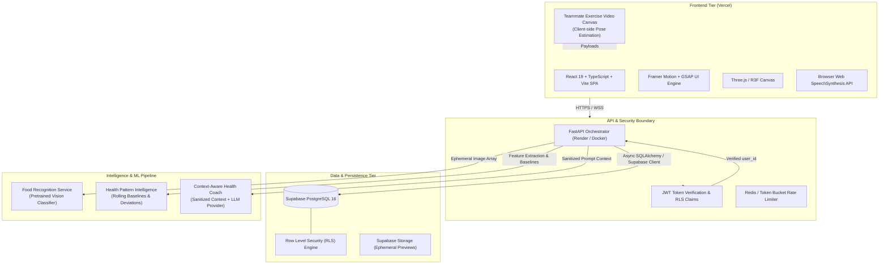

# HEALTH PLUS — System Architecture & Technical Design

> **Document Version:** 1.0.0  
> **Status:** Production Architecture Blueprint  
> **Author:** CASA Vital Engineering Architecture  

---

## 1. High-Level Architecture Overview

HEALTH PLUS follows a decoupled, cloud-native modular architecture separating client presentation, stateless business orchestration, persistent relational storage, and specialized intelligence services.



---

## 2. Component Breakdown & Boundaries

### 2.1 Frontend Tier (`frontend/`)
- **Technology:** React 19, TypeScript, Vite, Tailwind CSS, shadcn/ui primitives.
- **Role:** Pure presentation, optimistic UI rendering, client-side camera pose tracking, and audio synthesis.
- **Security Invariant:** The client stores no master API keys (no LLM keys, no vision keys, no database admin credentials). Only the public `SUPABASE_ANON_KEY` and backend `API_BASE_URL` are bundled.
- **State Management:** TanStack React Query for server state caching and optimistic updates; Zustand for lightweight client state (workout HUD, active audio state, scanner staging).

### 2.2 Backend Orchestrator (`backend/`)
- **Technology:** Python 3.13, FastAPI, Pydantic v2, Uvicorn, Asyncpg / SQLAlchemy.
- **Role:** Central gateway for all business logic, authentication token verification, input sanitation, diet calculation algorithms, and intelligence services orchestration.
- **Zero-Trust User Identity:**
  ```python
  # Core Authentication Principle:
  # user_id is extracted exclusively from the cryptographically verified Supabase JWT claims.
  # Client request payloads cannot specify or override user_id.
  async def get_current_user(token: str = Depends(oauth2_scheme)) -> AuthenticatedUser:
      claims = verify_supabase_jwt(token)
      return AuthenticatedUser(id=claims["sub"], email=claims["email"])
  ```

### 2.3 Persistence Tier (`supabase/`)
- **Technology:** PostgreSQL 16 managed by Supabase.
- **Data Isolation:** Enforced via native PostgreSQL Row Level Security (RLS). Every query executed on behalf of a user is constrained by `auth.uid() = user_id`.
- **Database as Source of Truth:** All nutrition totals, workout rep records, and historical baselines are stored in normalized relational tables.

---

## 3. Data Flow & Security Pipelines

### 3.1 Authentication & Request Flow
1. User authenticates with Supabase Auth via frontend SDK.
2. Supabase Auth returns a short-lived access JWT containing user UID (`sub`), role, and expiry.
3. React application attaches `Authorization: Bearer <JWT>` to every request dispatched to FastAPI.
4. FastAPI `AuthMiddleware` verifies JWT signature against the Supabase JWKS public key.
5. FastAPI constructs the authenticated session context and injects the verified `user_id` into repository services.
6. Supabase client in FastAPI queries PostgreSQL using the user's token or scoped service role applying strict user filtering.

### 3.2 Vision & Image Retention Security
1. When a user captures a food item, the image is transmitted as multipart form-data to `POST /api/v1/food/recognize`.
2. The image is parsed into memory in FastAPI (`io.BytesIO`) and submitted directly to the food classification pipeline.
3. **No Unnecessary Storage:** The raw image is discarded immediately after classification unless the user has explicitly checked "Save food photo in my diary" in their Privacy Settings.
4. If stored, images are encrypted at rest in a private Supabase Storage bucket with authenticated read-only presigned URLs with 1-hour expiration.

### 3.3 Exercise Camera Feed Boundary
1. The video stream generated by the device camera **never leaves the user's browser**.
2. Pose landmark detection, joint angle calculations, and rep counting run entirely client-side via WebAssembly/WebGL.
3. The platform only transmits lightweight structured JSON summaries (e.g. `{exercise: "squat", reps: 15, duration_s: 48, form_score: 92}`) to the backend upon session completion.

---

## 4. Intelligence & ML Architecture

### 4.1 Health Pattern Intelligence Pipeline
- **Execution Schedule:** Daily batch trigger (via Celery / APScheduler / Supabase Cron) + On-Demand request when user views `/insights`.
- **Pipeline Stages:**
  1. *Extraction:* Aggregate last 30 days of `meal_logs` and `workout_sessions` into daily vectors (`calories`, `protein_g`, `workout_volume`, `logging_completeness`).
  2. *Baseline Establishment:* Calculate 7-day and 28-day rolling means and standard deviations ($\mu, \sigma$).
  3. *Deviation & Correlation:* Calculate Z-scores ($Z = \frac{X - \mu}{\sigma}$). Flag deviations where $|Z| \ge 1.75$ with minimum 5 days of valid data in the window.
  4. *Evidence Assembly:* Attach exact contributing timestamps and values to prevent subjective speculation.

### 4.2 Context-Aware AI Coach RAG Pipeline
- **Grounding Architecture:**
  - LLM is never given direct internet access or asked to invent facts.
  - Context Payload contains:
    ```json
    {
      "user_profile": {"goal": "muscle_gain", "diet": "vegetarian", "allergies": ["peanuts"]},
      "recent_nutrition": {"7_day_avg_kcal": 2150, "7_day_avg_protein_g": 94},
      "recent_workouts": [{"date": "2026-11-08", "exercise": "squats", "reps": 36}],
      "active_patterns": ["High protein intake correlates with Tuesday/Thursday workouts"]
    }
    ```
  - **Clinical Safety Filter:** Outbound and inbound text is validated against safety regex and keyword classifiers. Any medical query (e.g., "I have chest pain after push-ups", "Can you prescribe metformin?") triggers a strict standard disclaimer instructing immediate medical consultation.

---

## 5. Deployment & Infrastructure Blueprint

| Service | Hosting Provider | Configuration | Scaling Strategy |
| :--- | :--- | :--- | :--- |
| **Frontend SPA** | Vercel | Global Edge Network, HTTP/2, Brotli compression, Cache-Control headers | Auto-scaling edge workers |
| **FastAPI Backend** | Render / Fly.io / AWS ECS | Docker container (Python 3.13-slim), Gunicorn + Uvicorn workers | Horizontal pod auto-scaling based on CPU/Memory |
| **Database & Auth** | Supabase Cloud | Managed PostgreSQL 16, Connection Pooling (PgBouncer), Daily automated backups | Compute tier scaling (Micro -> Small -> Medium) |
| **Storage** | Supabase Storage | S3-compatible, private bucket with signed URL access | Elastic managed storage |

