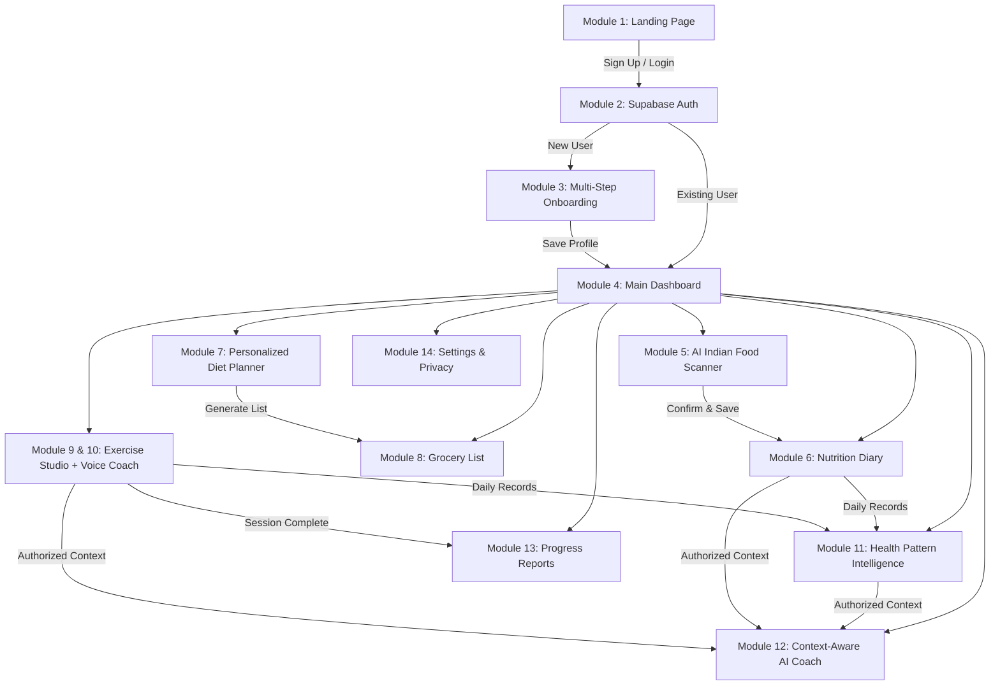
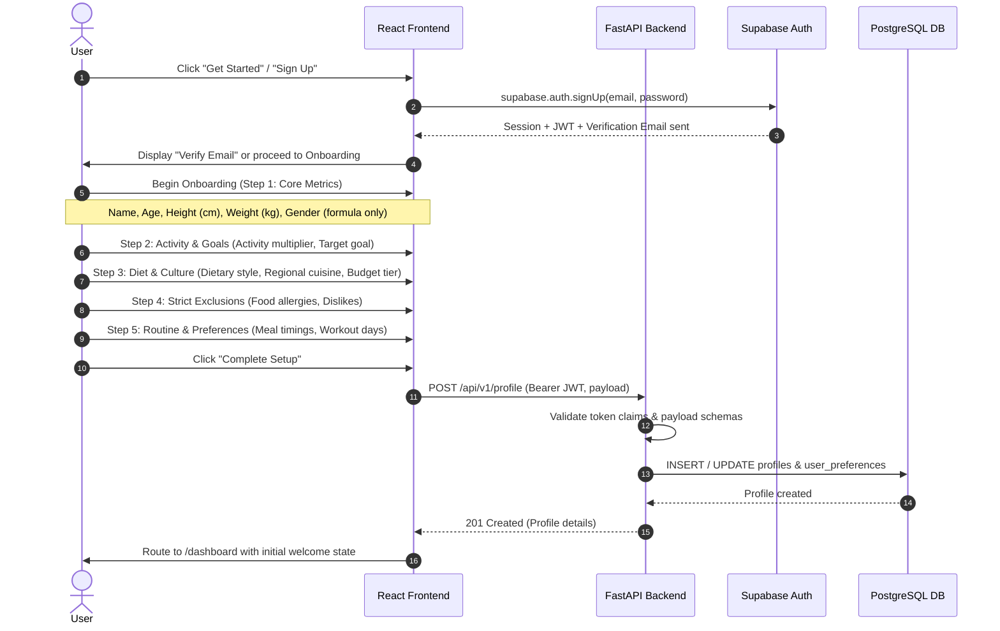
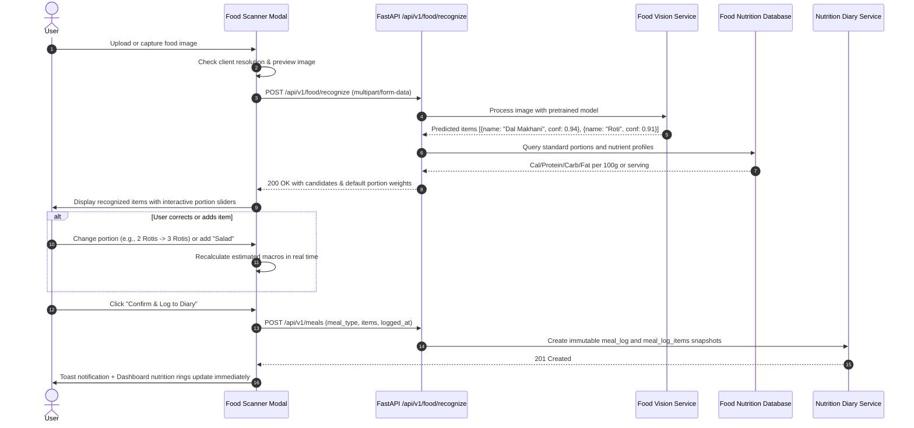
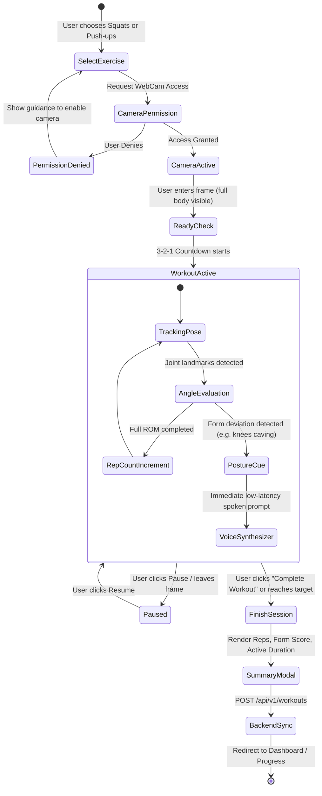
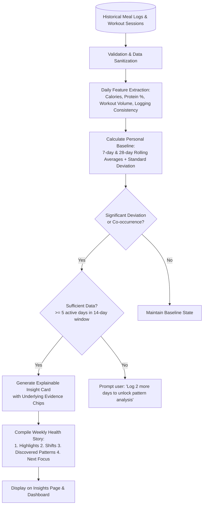

# HEALTH PLUS — Complete User Flows & Journey Maps

> **Document Version:** 1.0.0  
> **Status:** Production Architecture Blueprint  
> **Author:** CASA Vital Product & Engineering  

---

## 1. Flow Overview & Sitemap Matrix

---

## 2. User Flow 1: Authentication & Onboarding

### 2.1 Journey Narrative
The user visits HEALTH PLUS, signs up with email and password or OAuth via Supabase Auth, verifies their email, and enters a friendly, non-intimidating multi-step onboarding wizard. They supply baseline metrics needed for energy calculations and diet personalization, with optional fields clearly marked.

### 2.2 Detailed Step-by-Step State Flow

### 2.3 Edge Cases & Guardrails
- **Allergy Enforcement:** Allergies entered (e.g. "Peanuts", "Dairy") are stored as normalized tokens and flagged with strict exclusion priority in diet generation.
- **Optional Skip:** Non-essential fields (food budget tier, exact meal timings) can be skipped with a single click.
- **Data Editing:** Users can revise any attribute at any time from `/settings/profile`.

---

## 3. User Flow 2: AI Indian Food Scanner & Nutrition Diary

### 3.1 Journey Narrative
A user has a meal (e.g. roti, dal makhani, paneer bhurji). They take a photo or select an existing image. The scanner inspects image quality, detects food items using visual AI, presents candidate dishes with confidence scores, lets the user adjust portion sizes, retrieves verified nutrition data from the structured database, and records it to the user's Nutrition Diary.

### 3.2 Detailed Step-by-Step State Flow

### 3.3 Handling Uncertainty & Failure Modes
- **Blurry or Unidentifiable Food:** If confidence < 50%, system displays: *"We couldn't clearly identify this dish. Please search our database or enter details manually."*
- **Camera Permission Blocked:** Displays clear browser settings prompt with fallback to manual search bar.
- **Transparency Statement:** Card explicitly notes: *"Nutritional estimates are calculated based on standard serving sizes and may vary with cooking oils and recipes."*

---

## 4. User Flow 3: Personalized Diet Planner & Grocery List

### 4.1 Step-by-Step Flow
1. **Access:** User navigates to `/diet-planner`.
2. **Preference Check:** The system verifies current BMR/TDEE calculation and user dietary preferences (e.g., 2,100 kcal target, Vegetarian, North Indian, Peanut allergy).
3. **Plan Generation:** User clicks "Generate My Plan" or views the existing weekly schedule.
4. **Meal Inspection:** User expands any meal card (e.g., Lunch: Palak Paneer with Brown Rice) to inspect ingredients, cooking time, and macro breakdown.
5. **Swap Meal Action:** If user dislikes a suggested meal, they click "Swap Meal". The backend queries recipe templates matching the user's macro target (+/- 10%) and excluding allergens, offering 3 instant alternatives.
6. **Grocery List Sync:** User clicks "Export to Grocery List". The system combines all recipe ingredients, aggregates weights, groups by supermarket aisles (Vegetables, Grains, Dairy), and saves to `/grocery-list`.

---

## 5. User Flow 4: Exercise Studio & Adaptive Voice Coach

### 5.1 Journey Narrative
The user selects an exercise (Squats or Push-ups), positions their device camera, and initiates a live session. The camera feed assesses joint angles and posture in real-time, displays live skeleton wireframes, counts completed reps, and delivers instantaneous audio cues. When the session finishes, a structured performance summary is recorded to the backend.

### 5.2 Flow Chart

### 5.3 Biomechanical Safety & Confidence Thresholds
- **Confidence Check:** If landmark visibility score < 0.65 (e.g., lighting too dim or limbs cut off by frame), the system pauses rep evaluation and displays: *"Please adjust camera position so your full body is visible."*
- **Speech Throttling:** Spoken corrections have a minimum debounce cooldown of 4.5 seconds to avoid repetitive verbal clutter.

---

## 6. User Flow 5: Health Pattern Intelligence & Weekly Health Story

### 6.1 Systematic Processing Pipeline

### 6.2 Example Evidence-Based Presentation
- **Headline:** *"Consistent Post-Workout Protein Adherence"*
- **Observation:** *"On days you completed a workout session, your recorded protein intake averaged 108g (vs. 74g on non-workout days)."*
- **Evidence Toggle:** *"Based on 4 workouts logged between Nov 1 and Nov 7, 2026. Data completeness: 88%."*
- **Actionable Takeaway:** *"Maintaining this protein distribution supports muscle recovery without requiring extra meal preparation."*

---

## 7. User Flow 6: Context-Aware AI Personal Health Coach

### 7.1 Conversational Journey
1. **Initiation:** User clicks floating AI Coach widget or visits `/ai-coach`.
2. **Context Assembly:** FastAPI backend gathers authorized user context:
   - Profile metrics (Age, Goal, Allergies, Diet style)
   - Last 7 days nutrition aggregates (Average Calories, Macro split)
   - Recent workout performance (Completed reps, session frequency)
   - Active Health Pattern insights
3. **Safety Verification:** Pre-prompt security sanitizes user input, rejecting prompt-injection attempts and screening for acute clinical queries (e.g., chest pain, self-diagnosis, medication prescriptions).
4. **Contextual Grounding:** LLM prompt is injected with the verified metrics as structured JSON.
5. **Execution:** Response streams to the UI with clickable context tags (e.g. `[Referencing Nov 5-9 Workout Logs]`).
6. **Follow-Up Suggestions:** Three relevant next question chips appear beneath the response.

